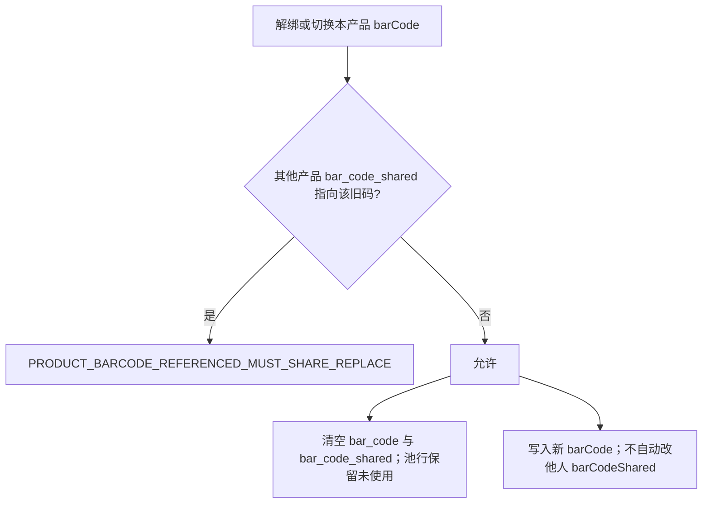

# 条形码管理系统 (BarCode Management System)

Last updated: 2026-11-08

## 概述

条形码管理系统负责商户条码池、产品绑定、共享引用与共享替换。锚点条码被其他产品 `barCodeShared` 引用时，**禁止直接解绑或换码**，须先在条码管理页做共享替换。绑定/解绑/共享变更写入使用记录，供历史审计。

## 核心概念

### 字段

| 字段 | 含义 |
|------|------|
| `barCode` | 产品自身绑定的条码（池中 `product_barcodes.code`） |
| `barCodeShared` | 共享引用：指向锚点产品的 `barCode`（可与自身相同，表示本产品为锚点） |
| `retained` | 池行保留态；`shared` 兼容历史「解绑后仍被引用」；新逻辑解绑后应置空 |

### 自码与共享码解耦

产品自己的 `barCode` 与指向别人的 `barCodeShared` **无业务耦合**：改/清共享码不触发锚点门禁；门禁只挡「**本产品 barCode 被他人 bar_code_shared 引用**」时的解绑或换码。

### EAN-13 / UPC-A

入库与按码查询一律 `barcodeUtil.normalizeEan13`（12 位前补 0）。见 `xituan_codebase/utils/barcode.util.ts`。

### 使用记录 action

`epProductBarcodeUsageAction`：`bind` | `unbind` | `share_set` | `share_clear` | `share_replace`。

## 门禁与解绑

- **停用**：解绑写 `retained=shared`；换码时 `syncBarCodeSharedReferences` 自动改依赖方。
- **允许路径**：条码管理页 **共享替换** → 引用清零 → 再解绑/换码。
- **管理页解绑**：`POST /admin/products/barcodes/:code/unbind` — 回池未使用（保留池行）。
- **产品编辑解绑**：【共享码】【历史】【解绑】顺序；解绑仅清表单字段，须手动保存；保存时后端再次门禁。

## 使用记录

表：`merchant.product_barcode_usage_logs`（HASH(`merchant_id`) 50 分区）。迁移：`1710000000405_product_barcode_usage_logs.sql`。

查询：`GET /admin/products/barcodes/usage?code=` 或 `?productId=`（倒序；附当前绑定产品）。

### UI

| 入口 | 内容 |
|------|------|
| 条码管理行「历史」 | 该码曾绑定过的产品事件 |
| 产品编辑条码旁「历史」 | 该产品用过的码 + 每码当前绑定产品；产品名链到编辑（CMS 新标签 `/products?openEdit=1&productId=`；App 栈内 ProductEdit） |

## API（admin）

| 方法 | 路径 | 说明 |
|------|------|------|
| GET | `/barcodes/usage` | 使用历史 |
| POST | `/barcodes/:code/unbind` | 池行解绑回未使用 |
| POST | `/barcodes/:barCodeId/replace-shared` | 共享替换 |
| GET | `/barcodes/:code/referrers` | 引用方列表 |

错误码：`PRODUCT_BARCODE_REFERENCED_MUST_SHARE_REPLACE`、`PRODUCT_BARCODE_UNBIND_NOT_BOUND`。

## 相关文档

- [BarCode-Shared-Cleanup-Guide.md](./BarCode-Shared-Cleanup-Guide.md)
