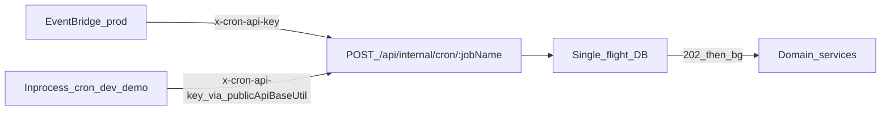

# Backend 统一定时任务（Internal Cron）

Last updated: 2026-11-10

## 目标

- 解决 **ECS 多 Task** 不能各自挂同一套 `node-cron` 的问题（重复执行），**不是**因为 Backend 算力不足而把业务迁出。
- 统一入口：`POST /api/internal/cron/:jobName` + API Key；业务事务仍在各域 service。
- production：EventBridge 到点触发；dev/demo：进程内 cron **HTTP 自调同一接口**（行为一致，不配 EB）。

## 架构



| 环境 | 触发源 | EB？ |
|------|--------|------|
| production | EventBridge Rule → API Destination → 公网 HTTPS（ALB） | 要 |
| development / demo | Backend `node-cron` HTTP 调同一路径 | 不要 |

自调 origin：**仅**用 [`publicApiBaseUtil.resolveBackendPublicOrigin()`](../../xituan_backend/src/shared/utils/public-api-base.util.ts)（`API_PUBLIC_ORIGIN` 或环境主域名），禁止写死 localhost。

## 鉴权

| 项 | 值 |
|----|-----|
| 请求头 | `x-cron-api-key` |
| Env | `INTERNAL_CRON_API_KEY`（必填于会触发的环境） |
| 轮换 | `INTERNAL_CRON_API_KEY_PREVIOUS`（可选） |

与 `JOB_CALLBACK_SECRET`（`/api/internal/jobs` HMAC）分开。EB Connection 选 **API Key**，与 Backend env 一致。

EventBridge API Destination HTTP 客户端超时约 **5s**：接口须 **验 key → 抢锁 → 立刻 202/200**，长任务在 **ECS 进程后台**跑；锁占用时快速 skipped，避免 EB 重试叠跑。

## 模块职责

| 层 | 职责 |
|----|------|
| cron API 模块 | 路由、验 key、单飞锁、快 ACK、按 `jobName` 分发 |
| 各业务模块 | Track 轮询、库存过期、首页缓存等**真实事务** |

`ENABLE_INPROCESS_CRON`：非 production 默认 true；production 强制 false。

## 单飞锁（现网能力与选型）

| 现有 | 说明 |
|------|------|
| `ICacheAdapter` | 仅 get/set/delete，**无** SET NX / 锁 API |
| `pg_advisory_xact_lock` | 见 preorderable sort-key；**事务级阻塞锁**，不适合「抢不到就跳过」的 cron 单飞 |
| Redis/Valkey | 技能允许做 lock；需另封装；跨 Task 可用 |

**拍板：最终保底用数据库**（可靠、不依赖 Redis 是否已接好）。

推荐实现（择一，优先表或 try advisory）：

1. **`pg_try_advisory_lock(hashtext(jobName))`**：抢到则跑，结束 `pg_advisory_unlock`；抢不到 → skipped。或  
2. **`platform.cron_job_locks`**（`job_name` PK、`locked_at`、`locked_by`、TTL/心跳）：`UPDATE … WHERE locked_at < now()-interval` 抢锁。

Redis SET NX+TTL 可作为后续加速层；**失败或未配置时回落 DB**，不以 Redis 为唯一真相。

## 第一期 job 清单（全做）

将现有 ECS 内 cron **迁到本框架**，并新增 MPB Track：

| jobName（示例） | 原服务 | 建议频率 |
|-----------------|--------|----------|
| `auspost-track-tick` | 新建 | 1 min |
| `inventory-expiry` 等 | `InventoryCronService` | ~5 min |
| `homepage-cache-sync` | `HomepageCacheCronService` | ~15 min |
| `metadata-search-outbox` | `MetadataSearchIndexCronService` | ~1 min |
| `subscription-expiration` | `SubscriptionExpirationCronService` | daily |
| `openim-unread-email` | `OpenimUnreadEmailCronService` | ~15 min |
| `account-deletion-anonymize` | `AccountDeletionService.anonymizeDueAccounts` | UTC 00:00 / 12:00；申请时 `due_at` 对齐到满 7 天后下一槽 |

production：各 job 一条 EB Rule + API Destination。dev/demo：进程内按原频率 HTTP 自调。

## 与 async jobs 关系

- **SQS → Lambda**（压图/OCR）：事件驱动重活，鉴权 HMAC，不变。
- **定时类**：本设计；Lambda **不做**长轮询主体。
- [`async-jobs-retention`](./planned-work/entries/2026-09-async-jobs-retention.md) 的 purge 可挂本框架一条 job，不再加 ECS 多实例 cron。

## Production EventBridge（CLI）

脚本：`xituan_agent/aws-setup/scripts/setup-internal-cron-eventbridge.sh`

```bash
export INTERNAL_CRON_API_KEY='…'   # 与 ECS / .env.production 同一把
export BACKEND_PUBLIC_ORIGIN='https://backend.xituan.com.au'
bash xituan_agent/aws-setup/scripts/setup-internal-cron-eventbridge.sh
```

资源：Connection `xituan-internal-cron`（头 `x-cron-api-key`）；Destination/Rule 前缀 `xituan-cron-<jobName>`；IAM `xituan-eventbridge-api-destination`。  
`subscription-expiration` 使用 `cron(0 16 * * ? *)`（约 AEST 02:00，UTC）。

**注意**：EB 打到公网 ALB；Backend 必须已挂载 `/api/internal/cron`（在 merchant `requestContextMiddleware` **之前**），且 ECS 有同名 key，否则会 401/落到「Merchant ID is required」。

## 相关

- Track 业务算法：[delivery/auspost-mpb-track-poll-design.md](./delivery/auspost-mpb-track-poll-design.md)
- planned-work：`auspost-mpb-track-poll`、`async-jobs-retention`
- Skill：`.cursor/skills/backend-internal-cron/SKILL.md`
- Async jobs 框架：[async-lambda-jobs-framework.md](./async-lambda-jobs-framework.md)
