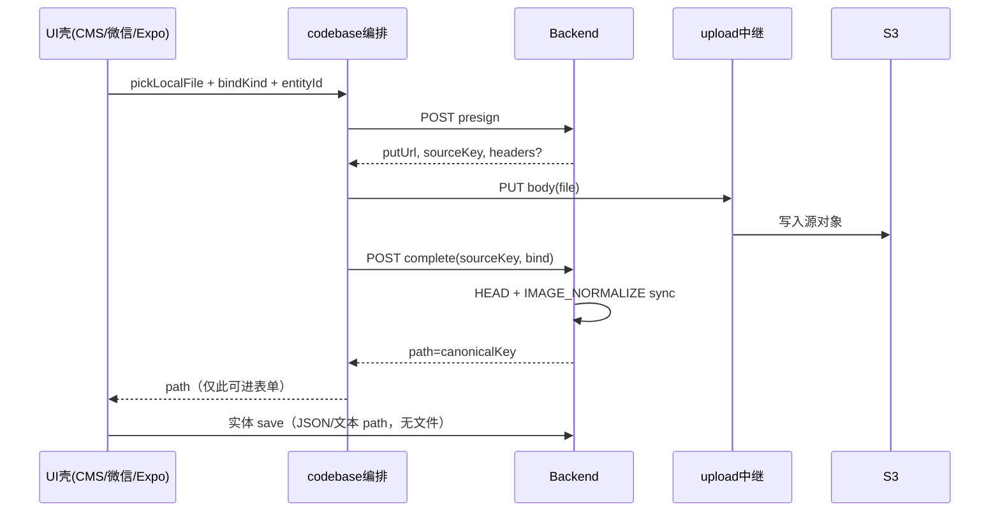

# 目录/业务图直传标准（多端复用）

Last updated: 2026-10-11

> **规划状态**：尚未实施。台账见 [`planned-work/entries/2026-10-catalog-image-direct-upload.md`](./planned-work/entries/2026-10-catalog-image-direct-upload.md)。  
> 本文是 **契约 + 分层标准**；实施时按本文件建可复用模块，禁止各端各写一套 presign/complete。

## 1. 目标

| 目标 | 做法 |
|------|------|
| 减 backend 带宽 | 文件二进制不经 ECS；只走 `presign` / `complete` JSON |
| 多端一致 | CMS / 微信商家 / Expo 商家 **同一 HTTP 契约**；UI 只换壳 |
| 落库正确 | `complete` 只返回 **canonical**（webp/png 按 bind kind）；表单只交 path 文本 |
| 少维护 | 编排逻辑进 **codebase**；各端只留 Transport + 薄 UI |

**首批端**：CMS、微信商家面板、Expo 商家 App。Site / 顾客 App 若日后有同类上传，复用同一契约与 codebase 编排，只加 Transport。

## 2. 端到端流程（唯一合法路径）

禁止：

- `complete` 前把源 path 写入业务表单并提交  
- `complete` 返回源 `.jpg/.png` 供客户端持久化  
- 各端私有「先 multipart 再猜扩展名」旁路（兼容期除外，见台账）

## 3. 分层（MVC 对齐）

用「契约 / 领域服务 / 适配器 / 视图」四层，对应常见 MVC，但 **跨多仓**：

| 层 | 职责 | 放哪里 | 禁止 |
|----|------|--------|------|
| **Contract（Model 契约）** | 请求/响应类型、`epImageNormalizeBindKind`、错误码形状 | `xituan_codebase`（`typing_api` / enum） | 各端复制 interface |
| **Orchestration（用例）** | `presign → PUT → complete` 状态机；重试/取消；返回 canonical path | `xituan_codebase` util（平台无关） | 在页面里手写三步 |
| **Transport（Adapter）** | HTTP：`fetch` / `wx.request` PUT / RN `fetch`；鉴权头 | 各 app 薄适配器，实现 codebase 注入的 `iCatalogImageUploadTransport` | 在 util 里写死 `wx` / `window` |
| **View（薄 UI）** | 选图、进度、多图列表、把 path 塞进表单字段 | CMS 组件 / 微信 component / Expo component | 组件内直接调 S3 或拼 SIH |

Backend 内同样分层：

| 层 | 职责 | 建议位置 |
|----|------|----------|
| **Controller** | 鉴权、merchant 上下文、参数校验、HTTP 映射 | 共享路由模块（如 `catalog-image-upload`）或现有 domain 下统一 controller |
| **Service** | 生成 key、presign、HEAD、enqueue normalize、回 canonical | **一个** `CatalogImageDirectUploadService`（或同名），Offer/Product 只传 bind |
| **Infra** | S3 / upload 中继签名、`imageNormalizeEnqueueUtil` | 现有 `s3UploadManager` + jobs；不复制 normalize |

实体 Create/Update（Offer 等）**只收 path**，不再收文件；业务 Controller 不感知 PUT。

## 4. 共享契约（草案字段）

实施时以 codebase 类型为准；语义必须稳定：

**presign**

| 字段 | 说明 |
|------|------|
| `bindKind` | `epImageNormalizeBindKind` |
| `entityId` | 业务实体 id（可先占位再绑） |
| `contentType` / `byteSize` | 校验用 |
| 响应 `putUrl` | **一律 upload 中继 Host**（与 OpenIM 直传共用策略） |
| 响应 `sourceKey` | 源对象 key（仅 complete 用，不进表单） |

**complete**

| 字段 | 说明 |
|------|------|
| `sourceKey` | 与 presign 一致 |
| `bindKind` / `entityId` / `merchantId` | 进 IMAGE_NORMALIZE bind |
| 响应 `path` | **仅** canonical（normalize 后） |
| 响应可选 `variantsReady` | 布尔；失败则整单失败，不返回源 path |

表单字段：`headerImage` / `featuredImages[]` 等 = `complete.path`。

## 5. Codebase 可复用模块（命名草案）

| 模块 | 职责 |
|------|------|
| `catalog-image-direct-upload.type.ts` | `iCatalogImagePresignRequest/Response`、`iCatalogImageCompleteRequest/Response`、`iCatalogImageUploadTransport` |
| `catalog-image-direct-upload.util.ts` | `uploadOne({ file, bind, transport })` → `Promise<{ path }>`；多图 `uploadMany` |
| （可选）`catalog-image-form-paths.util.ts` | 合并 retained paths + 新 canonical；删图 diff（替代各端抄 FormData currentImages 逻辑） |

`iCatalogImageUploadTransport` 最小面：

- `presign(body) → response`  
- `putObject(putUrl, body, contentType, onProgress?)`  
- `complete(body) → { path }`  

各端实现一个 transport，**页面只调 `catalogImageDirectUploadUtil.uploadOne`**。

## 6. 各端 View 约定（薄壳）

| 端 | View 形态 | 内部只做 |
|----|-----------|----------|
| **CMS** | 如 `CatalogImageDirectUpload`（Ant Upload 定制） | 选文件 → 调 util → `currentImages` / Form 字段写 path；submit **无** file |
| **微信商家** | component + 选图 API | 同上；PUT 走 request 合法域名（upload 中继） |
| **Expo 商家** | 共享 RN 小组件或 hook | 同上；与微信共用 util，仅 transport 不同 |

CMS 现有 FormData 图片文档（[`FormData-Image-Management-System.md`](./FormData-Image-Management-System.md)）在迁移后：**保留「path 列表 / 删除 diff」语义**，删除「multipart 文件字段」；skill `cms-form-image-upload` 同步改为直传 checklist。

## 7. Backend 可复用面

- **一个** presign + **一个** complete 入口（query/body 带 `bindKind`），不要 Offer/News 各抄一套签名逻辑。  
- Key 布局仍按实体（`merchant/.../offer/.../headerImage/...`），由 service 按 bindKind 分支生成前缀。  
- `complete` 内强制：`canonicalKeyFromJob`；无 canonical → 4xx/5xx，禁止降级回源 key。  
- 与 OpenIM：**共用 upload 中继 infra**；业务 API 与 IM attachments **分路由**，避免会话权限缠进目录图。

## 8. 与支出 OCR / OpenIM 的边界

| 能力 | 目录图（本标准） | 支出 OCR | OpenIM 附件 |
|------|------------------|----------|-------------|
| PUT Host | upload 中继（目标） | 现 `amazonaws.com`（可后置） | upload 中继（planned） |
| complete 后 | 业务表 path = canonical | OCR 管线 | 聊天 URL = canonical |
| 复用 | transport 模式 / 中继 | 仅作 presign 参考 | 中继 +「complete 回 webp」参考 |

**不要**把支出 OCR 强行并进本 util（bind/鉴权不同）；**要**复用「presign→PUT→complete→canonical」形状与中继。

## 9. 实施顺序（降维护成本）

1. codebase：类型 + `uploadOne` + transport 接口（无 UI）  
2. backend：统一 presign/complete service + 路由  
3. 一端打通（建议微信商家 Offer 头图/轮播）验契约  
4. Expo 商家换 transport  
5. CMS 换薄组件，实体逐个去 FormData 文件字段  
6. post-deploy：删旧 multipart 收文件 API  

## 10. 验收（标准级）

- [ ] 三端上传同一张图，DB path 扩展名符合 bind policy（多为 `.webp`）  
- [ ] 任意端抓包：实体 save **无** multipart 文件  
- [ ] 编排代码只在 codebase 一处；端上无第二套三步流程  
- [ ] `complete` 失败时表单不出现源 key  
- [ ] 微信仅配置 upload 中继为 request 合法域名，不配 S3 主机  

## 相关文档

- [planned-work entry](./planned-work/entries/2026-10-catalog-image-direct-upload.md)
- [openim-attachment-direct-upload](./planned-work/entries/2026-09-openim-attachment-direct-upload.md)
- [async-lambda-jobs-framework](./async-lambda-jobs-framework.md)
- [media-cdn-sih-domain-split](./media-cdn-sih-domain-split.md)
- [FormData-Image-Management-System](./FormData-Image-Management-System.md)（as-is）
- Skill：`image-normalize-variant-policy`、`cms-form-image-upload`（迁移时改）
