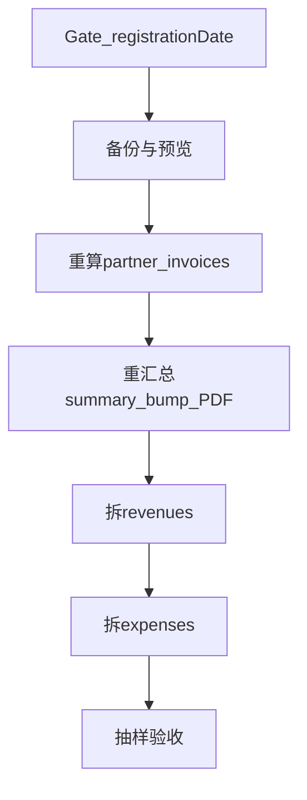

# GST 生效日切齐（等 ATO 确认 D）

Last updated: 2026-10-30

> **规划台账：** [planned-work `gst-effective-date-cutover`](../planned-work/entries/2026-10-gst-effective-date-cutover.md)（状态 `blocked`；**仅 todo，拿到 D 前不实施**）  
> **巡检口令：**「检查规划」→ registry 本条  
> **未决：** 生效日 D、先跑哪家 merchant、FY 纠错是否先 migrate、WP-D 脚本 — 见 entry「未决 / 待标」  
> **SQL/字段细节补充：** [`docs/gst/gst-effective-date-amount-cutover.md`](../../docs/gst/gst-effective-date-amount-cutover.md)  
> **禁止**未批准跑生产 SQL（见 migration-sql / data-repair 规则）

---

## 1. 结论（一句话）

税务局把 GST **生效日 D** 定下来并写入 CMS 设置后，只对 **业务日 ≥ D** 的账本/票补拆或重算 GST；**&lt; D** 保持未注册计法（纠错窗口已另做，见下）。

判定：`gstRegistrationUtil.isRegisteredOnDate(gst, eventDate)` → `eventDate >= D` 且已注册才计税。

---

## 2. 与 WP-0 / 纠错的边界

| | WP-0 + FY 纠错 | 本切齐（等 D） |
|--|----------------|----------------|
| 代码 | 未注册日强制 gst=0；CMS 禁「含 GST」 | 一般**不再改代码**（新单靠设置自动拆） |
| 数据 | `scripts/data-repair/jobs/gst-unregister-fy2025-revenues-expenses/`（preview 已写；migrate 须批准） | `scripts/data-repair/jobs/gst-effective-date-revenues-expenses/`（占位 `__GST_D__`；须批准） |
| 合作票 | 现网未注册 PDF 多为 gst=0 → 纠错轮**可不重算票** | D 后若 `issue_date >= D` 仍 gst=0 → **脚本重算** + bump PDF |

手续费 / OmiPay 18.18→18 → **独立** plan，勿与本批混脚本。

---

## 3. Gate（执行前必须全部勾上）

- [ ] ATO 书面/系统确认 → **`D = YYYY-MM-DD`**
- [ ] CMS 财务：`finance.gst.isRegistered = true`
- [ ] CMS 财务：`finance.gst.registrationDate = D`
- [ ] 确认 `isPriceInclusiveGst`（现网默认 **价内 true**：实付/total 不改，只拆 gst/net）
- [ ] 选定 `merchant_id`（多租户逐商户）
- [ ] DB 备份；预览 `SELECT` 行数/金额已人工复核
- [ ] 开发者**明确批准**跑 UPDATE / 重算脚本

Gate 写完后：**新**创建的收入/支出/新开票会按 D 自动走注册逻辑；历史行仍靠下面批量。

---

## 4. 工作包（仅 ≥ D）

### WP-A — 配置 Gate

只写设置，不改业务行。

### WP-B — 收入 `merchant.revenues`

| 项 | 规则 |
|----|------|
| 范围 | `revenue_date >= D`，`ABS(gst_amount)≈0`，排除 `loan_from_director` |
| 动作 | 价内：`gst = round(|total|/11,2) * sign`，`net = total - gst`（**保留退款负号**） |
| `&lt; D` | **不动** |

执行：替换 job 内 `DATE '__GST_D__'` 后 `npm run migrate:script:data-repair` → 选 `gst-effective-date-revenues-expenses`（先 preview）。示意亦见 docs cutover §C4。

### WP-C — 支出 `merchant.expenses`

| 项 | 规则 |
|----|------|
| 范围 | `expense_date >= D`，gst≈0；排除 `loan_to_director` / `fine`；价外或复杂 OCR **不进自动 SQL** |
| 动作 | 价内补拆 gst/net（退款行同样带符号） |
| 口径 | 库里 `gst_amount` = **可抵扣进项**；报税成本用 `net_amount` |
| `&lt; D` | **不动**（成本保持总额） |

与 WP-B **同一 job**（`gst-effective-date-revenues-expenses`）。价外/复杂 OCR 勿依赖自动 SQL。示意亦见 docs cutover §C5。

### WP-D — 合作送货单 / 结算单

| 项 | 规则 |
|----|------|
| 送货单 | `issue_date::date >= D` 且 gst 仍为 0 → **脚本**调 `calculateInvoiceDetailItem` 等重写 `detail`+头字段（禁止手改 JSONB） |
| 结算单 | 所含发票重算后重汇总；`doc_content_version += 1` |
| 产品 | 已注册：PDF 正常显示 GST；未注册历史：×10/11 且 gst=0（纠错轮已定可不重算） |
| 候选预览 | 已并入 job `gst-effective-date-revenues-expenses` 的 preview §5–§6；**migrate 不含票** |
| 到日脚本（未写文件，按下表实现） | 见下方「WP-D 脚本要点」；**禁止**手改 JSONB |

#### WP-D 脚本要点（有 D 后再实现/跑）

1. CLI：`npx ts-node scripts/gst-effective-date-partner-invoices.ts <env> --d=YYYY-MM-DD [--merchant=uuid] [--apply]`；默认仅 dry-run 打印候选。  
2. 读设置确认 `isRegistered` + `registrationDate === D`（Gate）。  
3. 候选：`(issue_date AT TIME ZONE 'UTC')::date >= D` 且 `gst≈0` 且 `total>0`（与 preview §5 一致）。  
4. 对每张票：按行 `productId`+`quantity` 调 `calculateInvoiceDetailItem(..., isGstRegistered=true, isPriceInclusiveGst)`；汇总用 `calculateInvoiceSummary`；`UPDATE` 头字段 + `detail`；关联 summary 重汇总并 `doc_content_version += 1`（可参考 `partner.repository` bump 方法）。  
5. 抽查 PDF 后再对生产 `--apply`。

### WP-E — PDF

| 单据 | 策略 |
|------|------|
| 订单 TAX INVOICE / RECEIPT | 无存库 gst 列；设好 D 后按业务日**现算**；对需归档的 `>= D` 触发重生成 |
| 合作送货/结算 PDF | bump version 后走现有生成；抽查含税栏 |

### WP-F — 验收

- [ ] `&lt; D` 收支抽样 gst 仍为 0  
- [ ] `>= D` 收入有销项；适用支出有进项；报税成本为 net  
- [ ] 合作票 / 订单 PDF：D 后有 GST，D 前无  
- [ ] 本 planned-work entry → `done`，registry 归档  

---

## 5. 运维日顺序（仅 GST）

```text
Gate(A) → 备份/预览
  → 送货单脚本(D) → 结算单汇总 + PDF(E)
  → 收入 SQL(B) → 支出 SQL(C)
  → 订单 PDF 抽检/重生成(E)
  → 验收(F)
```



---

## 6. 明确不做

- 把 `业务日 < D` 强行改成含 GST  
- 与手续费 / OmiPay 已收款订正混同一批次  
- 未批准的生产 SQL  
- 站内提现  

---

## 相关文档

- [本目录 README](./README.md)
- [planned-work entry](../planned-work/entries/2026-10-gst-effective-date-cutover.md)
- [planned-work registry](../planned-work/registry.md)
- 细节 SQL：[`docs/gst/gst-effective-date-amount-cutover.md`](../../docs/gst/gst-effective-date-amount-cutover.md)
- 历史任务稿：[`docs/gst/TASK-2-gst-effective-date-cutover.md`](../../docs/gst/TASK-2-gst-effective-date-cutover.md)（以本文为准）
- 纠错 SQL：`xituan_backend/scripts/data-repair/jobs/gst-unregister-fy2025-revenues-expenses/`
- **D 切齐 SQL：** `xituan_backend/scripts/data-repair/jobs/gst-effective-date-revenues-expenses/`（先替换 `__GST_D__`）
- Cursor plans：`gst_registration_respect`、`gst_wp-0_cutover`（WP-0 已完成；D 切齐挂本台账）
