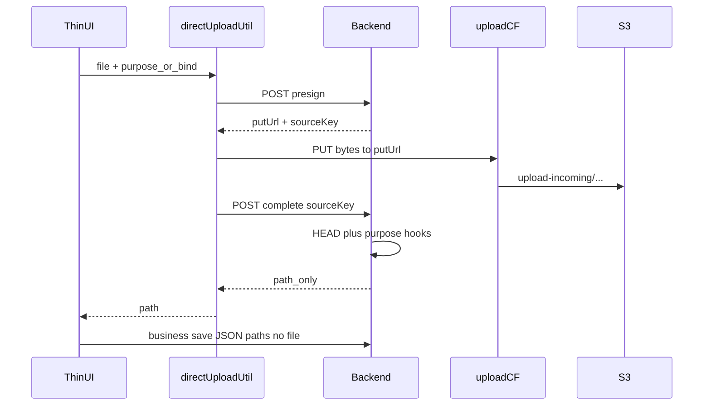

# 图片上传面清单与直传迁移差异

Last updated: 2026-11-13

> **状态**：通用直传**框架已落地**（`directUploadUtil` + upload 写分布）；业务页尚未迁。  
> 本文 = **上传面清单** + **怎么迁** + **各 case 不可避免的差异** + **典型流程复述**。  
> PUT 主机权威：[S3 直传约定](../../.cursor/skills/s3-direct-upload/reference.md)。  
> 业务 Cursor plan：[direct_upload_business_migration_2026-11.plan.md](../../.cursor/plans_planned/direct_upload_business_migration_2026-11.plan.md)。

## 1. 典型流程（全仓唯一合法形状）

复述要点：

1. **presign**：鉴权后签发短时 `putUrl`（CloudFront canned 签名）；对象先落在 `upload-incoming/`。客户端**不解析、不改 Host**。
2. **PUT**：各端 Transport 只负责把本地字节打到 `putUrl`（Web `fetch` / RN `File.upload` / 微信 `wx.request`）。禁止 FormData 包一层、禁止 RN `fetch(file://)`。
3. **complete**：校验归属 + HEAD；再按 **purpose / bindKind** 跑差异化 hook（见 §3）；响应**只回可持久化的 path**（目录图多为 IMAGE_NORMALIZE 后的 canonical）。
4. **业务 save**：实体接口只收 path 文本 / JSON；**不再**带 multipart 文件。

框架期 `purpose=probe` 的 complete 只 HEAD，`path = sourceKey`。业务接入后**禁止**把源 `.jpg/.png` 当最终 path 写进表单。

编排只在 codebase `directUploadUtil`；页面禁止第二套三步状态机。

---

## 2. 上传面清单（bind × 通道）

权威 bind 枚举：`xituan_codebase/constants/image-normalize-bind-kind.enum.ts`。  
C3 接线说明：[async-lambda-jobs-framework.md](./async-lambda-jobs-framework.md) §C3。

| bind.kind | 业务 | 典型入口 | as-is 上传 | 迁移桶 | 备注 |
|-----------|------|----------|------------|--------|------|
| `product_images` | 商品图 | CMS FormData；商家 App 产品编辑 | multipart | **A 目录图** | 多图；CMS 与 App 都要改 |
| `news_images` | 新闻图 | CMS | FormData | **A** | 可后于 Offer/Preorder |
| `offer_header_image` | 团购头图 | CMS；微信/Expo `.../offers/:id/images/:kind` | FormData / 两步 multipart | **A 优先** | |
| `offer_featured_images` | 团购特色/轮播 | 同上 | 同上 | **A 优先** | |
| `preorder_header_image` | 预定头图 | CMS；微信 `.../preorder-promotes/.../images/:kind` | FormData / 两步 | **A 优先** | |
| `preorder_carousel_images` | 预定轮播 | 同上 | 同上 | **A 优先** | |
| `product_preset_preview` | 选项预览图 | CMS preset | multipart single | **A** | |
| `merchant_logo` / `merchant_logo_rect` | 商户 logo | CMS/设置 | multer fields | **A** | policy 为 **png** |
| `cart_note_images` | 购物车备注图 | Site/微信 `POST .../upload-images` | multipart | **C 顾客侧** | user-scoped；可无 merchantId |
| `order_note_images` | 订单行备注图 | 下单自 cart 转移 | 非独立上传 UI | — | 一般不新开上传 |
| `user_avatar` | 头像 | Site/微信 auth | multipart | **C** | user-scoped |
| `expense_receipt` | 费用收据 | CMS 支出 OCR | **已直传 amazonaws.com** | **不迁** | 保持 SigV4；不进 upload CF |
| `print_temp_image` | 打印模板图 | CMS `/:id/images` | multipart | **D 另议** | png；path 常嵌模板 JSON |
| `openim_chat_image` | 聊天图片 | 各端 OpenIM attachments | multipart | **B OpenIM** | GIF 跳过 normalize；PDF 不 enqueue |
| `barcode` | 店面码等 | 多为系统生成 | — | 通常不迁 | 非用户选图主路径 |

### 通道 as-is（横切）

| 通道 | 形态 | 迁到 |
|------|------|------|
| CMS 实体编辑 | 创建/更新 **同一请求 FormData** 带图 | 先直传拿 path → 实体 save 只交文本 |
| 微信 / Expo 商家 | **两步**：`POST .../images/:kind` multipart → 再 PUT 文本 | 删两步中的 multipart；直传 + 文本 save |
| OpenIM | `POST .../attachments` multipart | 直传 + complete 回 canonical / cdnUrl |
| 支出 OCR / OTA | 已 SigV4 → `amazonaws.com` | **维持**；勿并入 upload CF |

Multer 路由枚举（排障用）：[request-context-multer-audit.md](../docs/request-context-multer-audit.md)。

---

## 3. 怎么迁（建议顺序）

统一原则：**扩展现有 `DirectUploadService` + `directUploadUtil`**，不要平行再建 `CatalogImageDirectUploadService` 状态机。

| 步 | 内容 | 状态 |
|----|------|------|
| 0 | 框架已完成（本表不重复） | done |
| 1 | 扩 `purpose` / 传入 `bindKind`；`complete` 挂 IMAGE_NORMALIZE **sync** | planned |
| 2 | **按端**迁目录图等（Expo 商家、CMS、Site/顾客 App、微信顾客包…） | planned |
| 2b | **备注图 / 头像**：不单独立项；**随该端步 2 一并合并** | planned |
| 3 | **打印模板 + OpenIM** 同批后置 | planned |
| 4 | 孤儿 TTL（`upload-incoming` 未 complete） | planned |
| 5 | 发版无流量后 **post-deploy** 下线旧 multipart | planned |

**忽略（不排期）**：微信商家「我的网店」深链下的全部功能。OCR 决定搁置。

台账：

- A：[catalog-image-direct-upload](./planned-work/entries/2026-10-catalog-image-direct-upload.md)  
- B：[openim-attachment-direct-upload](./planned-work/entries/2026-09-openim-attachment-direct-upload.md)  
- 标准（目录图分层）：[catalog-image-direct-upload-standard.md](./catalog-image-direct-upload-standard.md)

---

## 4. 各 case 不可避免的差异化

下列差异**不应**用「再写一套 PUT」解决；应落在 **presign 校验 / complete hook / 鉴权路由 / 端上选图**，Transport 与三步编排保持同一套。

| 维度 | 目录/业务图 (A) | OpenIM (B) | 支出 OCR | 顾客备注图/头像 (C) |
|------|-----------------|------------|----------|---------------------|
| **PUT 主机** | upload CF | 同左 | **amazonaws.com**（不改） | upload CF |
| **鉴权路由** | 商户 admin（CMS/商家面板） | 会话成员 + IM 附件 API | 商户 admin | **顾客** JWT（customer 路由） |
| **presign 入参** | `bindKind` + `entityId` + MIME/size | 会话/附件元数据 + MIME/size | 现有 expense batch 契约 | bindKind + userId |
| **complete hook** | HEAD → **IMAGE_NORMALIZE sync** → canonical | HEAD → 附件落库 → 图则 normalize → **cdnUrl** 给 OpenIM | OCR/Textract 管线 | HEAD → normalize → path |
| **最终 path 形态** | 多为 `.webp`；logo **png** | 聊天侧要 **可展示 URL**（不只 key） | 收据图 + OCR 结果 | webp/avatar policy |
| **variant policy** | 按 bindKind（见 skill） | chat image 策略 | **仅 s256 + canonical** | avatar / note 策略 |
| **选图 / 端坑** | CMS Ant Upload；微信选图；Expo：**Android DocumentPicker**（防 image-picker 崩溃）；iOS 权限/HEIC | 各端 IM 选文件；微信 PUT 走 request 域名 | CMS 文件选择 | Site/微信顾客端 |
| **业务 save** | 实体 JSON path 列表 + 删图 diff | 发消息带 complete 返回的 URL | 费用单字段 | cart/user API |
| **旧 API 下线** | FormData 文件字段 + `images/:kind` | `POST .../attachments` multipart | 无（已直传） | `upload-images` / avatar multipart |
| **明确不做** | — | 不回填历史 Mongo `.png` | 不迁 upload CF | — |

### 还必须差异、但不要分叉协议的点

1. **purpose / bindKind**：决定 key 前缀、normalize 与否、回写哪张表——这是合法分支。  
2. **商户 vs 顾客路由**：同一 Service，不同 middleware（已有 admin / customer 镜像）。  
3. **web vs wechatUpload host**：仅签名 Host 不同（prod 微信 `upload.lancety.com`），Transport 仍吃不透明 `putUrl`。  
4. **format=png 的 kind**（logo、print_temp）：complete 后扩展名与 webp 类不同，仍走同一 complete。  
5. **非图片附件**（OpenIM PDF 等）：可走直传 PUT，但 **不** IMAGE_NORMALIZE。

### 禁止的「假差异」

- 为微信单独签 S3、为 CMS 签 upload（双 Host）。  
- 各实体各抄一套 presign。  
- complete 失败时把源 key 塞进表单「先保存」。  
- Android 产品多图改回 `expo-image-picker`（生产崩溃史，见 skill `s3-direct-upload-android`）。

---

## 5. 与框架能力的映射

| 已有 | 业务迁入时 |
|------|------------|
| `epDirectUploadPurpose.probe` | 增业务 purpose，或 purpose + bindKind 字段 |
| `DirectUploadService.complete` → `path=sourceKey` | hook：normalize / 附件表 / 返回 canonical |
| `directUploadUtil` + 各端 Transport | UI 只换薄壳；不必再写 transport |
| Jest（归属、probe 限额） | 扩：bindKind ownership、normalize mock、跨租户 |

---

## 相关文档

- [S3 直传约定](../../.cursor/skills/s3-direct-upload/reference.md)
- [catalog-image-direct-upload-standard.md](./catalog-image-direct-upload-standard.md)
- [FormData-Image-Management-System.md](./FormData-Image-Management-System.md)（CMS as-is）
- [async-lambda-jobs-framework.md](./async-lambda-jobs-framework.md) §C3
- Skill：`image-normalize-variant-policy`、`cms-form-image-upload`、`s3-direct-upload-ios` / `-android`
- Plan：[`direct_upload_business_migration_2026-11.plan.md`](../../.cursor/plans_planned/direct_upload_business_migration_2026-11.plan.md)
