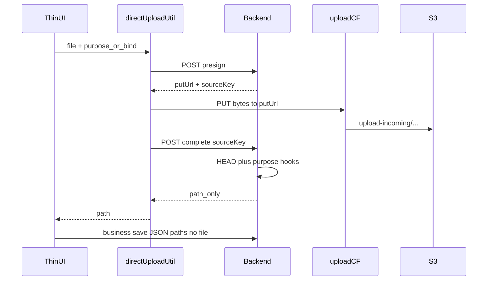

# 图片上传面清单与直传迁移差异

Last updated: 2026-11-13

> **状态**：通用直传**框架已落地**（`directUploadUtil` + upload 写分布）；业务页尚未迁。  
> 本文 = **上传面清单** + **怎么迁** + **各 case 不可避免的差异** + **典型流程复述**。  
> PUT 主机权威：[S3 直传约定](../../.cursor/skills/s3-direct-upload/reference.md)。  
> 业务 Cursor plan：[direct_upload_business_migration_2026-11.plan.md](../../.cursor/plans_planned/direct_upload_business_migration_2026-11.plan.md)。

## 1. 典型流程（全仓唯一合法形状）



复述要点：

1. **presign**：鉴权后签发短时 `putUrl`（CloudFront canned 签名）；对象先落在 `upload-incoming/`。客户端**不解析、不改 Host**。
2. **PUT**：各端 Transport 只负责把本地字节打到 `putUrl`（Web `fetch` / RN `File.upload` / 微信 `wx.request`）。禁止 FormData 包一层、禁止 RN `fetch(file://)`。
3. **complete**：校验归属 + HEAD；再按 **purpose / bindKind** 跑差异化 hook（见 §3）；响应**只回可持久化的 path**（目录图多为 IMAGE_NORMALIZE 后的 canonical）。
4. **业务 save**：实体接口只收 path 文本 / JSON；**不再**带 multipart 文件。

框架期 `purpose=probe` 的 complete 只 HEAD，`path = sourceKey`。业务接入后**禁止**把源 `.jpg/.png` 当最终 path 写进表单。

编排只在 codebase `directUploadUtil`；页面禁止第二套三步状态机。

---

## 2. 上传面清单（bind × 通道）

权威 bind 枚举：`xituan_codebase/constants/image-normalize-bind-kind.enum.ts`。  
C3 接线说明：[async-lambda-jobs-framework.md](./async-lambda-jobs-framework.md) §C3。

| bind.kind | 业务 | 典型入口 | as-is 上传 | 迁移桶 | 备注 |
|-----------|------|----------|------------|--------|------|
| `product_images` | 商品图 | CMS FormData；商家 App 产品编辑 | multipart | **A 目录图** | 多图；CMS 与 App 都要改 |
| `news_images` | 新闻图 | CMS | FormData | **A** | 可后于 Offer/Preorder |
| `offer_header_image` | 团购头图 | CMS；微信/Expo `.../offers/:id/images/:kind` | FormData / 两步 multipart | **A 优先** | |
| `offer_featured_images` | 团购特色/轮播 | 同上 | 同上 | **A 优先** | |
| `preorder_header_image` | 预定头图 | CMS；微信 `.../preorder-promotes/.../images/:kind` | FormData / 两步 | **A 优先** | |
| `preorder_carousel_images` | 预定轮播 | 同上 | 同上 | **A 优先** | |
| `product_preset_preview` | 选项预览图 | CMS preset | multipart single | **A** | |
| `merchant_logo` / `merchant_logo_rect` | 商户 logo | CMS/设置 | multer fields | **A** | policy 为 **png** |
| `cart_note_images` | 购物车备注图 | **微信/Site/顾客 App 已直传** | direct | **C 顾客侧** | 微信 wait；Site/顾客 App **no-wait** + `_w*` onError→原图 |
| `order_note_images` | 订单行备注图 | 下单自 cart 转移 | 非独立上传 UI | — | 一般不新开上传 |
| `user_avatar` | 头像 | **微信/Site/顾客 App 已直传**（complete 落库） | direct | **C** | waitNormalize；端上后 getMe |
| `expense_receipt` | 费用收据 | CMS 支出 OCR | **已直传 amazonaws.com** | **不迁** | 保持 SigV4；不进 upload CF |
| `print_temp_image` | 打印模板图 | CMS 编辑器直传 | **direct wait** | **CMS done** | png；path 嵌模板 JSON；商家 App 仅只读选模板 |
| `openim_chat_image` | 聊天图片 | **CMS/Site 已直传**；微信/App 仍 multipart | direct / multipart | **B OpenIM** | CMS/Site：域内 presign→PUT→complete；GIF 跳过 normalize；PDF 不 enqueue |
| `barcode` | 店面码等 | 多为系统生成 | — | 通常不迁 | 非用户选图主路径 |

### 通道 as-is（横切）

| 通道 | 形态 | 迁到 |
|------|------|------|
| CMS 实体编辑 | 创建/更新 **同一请求 FormData** 带图 | 先直传拿 path → 实体 save 只交文本 |
| 微信 / Expo 商家 | **两步**：`POST .../images/:kind` multipart → 再 PUT 文本 | 删两步中的 multipart；直传 + 文本 save |
| OpenIM | CMS/Site：`attachments/presign`→PUT→`complete`；微信/App：`POST .../attachments` multipart | complete 回 canonical / cdnUrl；multipart 保留至 Gate |
| 支出 OCR / OTA | 已 SigV4 → `amazonaws.com` | **维持**；勿并入 upload CF |

Multer 路由枚举（排障用）：[request-context-multer-audit.md](../docs/request-context-multer-audit.md)。

---

## 3. 怎么迁（建议顺序）

统一原则：**扩展现有 `DirectUploadService` + `directUploadUtil`**，不要平行再建 `CatalogImageDirectUploadService` 状态机。

| 步 | 内容 | 状态 |
|----|------|------|
| 0 | 框架已完成（本表不重复） | done |
| 1 | purpose=`image` + bindKind + complete 双模式（promote 出 upload-incoming → IMAGE_NORMALIZE） | **backend done**（端上未接） |
| 2 | 孤儿 TTL = **24h**（lifecycle 脚本已备；桶上待执行） | **script done** |
| 3 | **一次一端**：微信（顾客）→ Site → 顾客 App → CMS → 商家 App；备注图/头像并入 | **微信顾客 done**；**Site done**；**顾客 App done**；**CMS catalog/logo/compliance/preset done**（no-wait）；商家 App catalog **done**（并行已落地） |
| 4 | **打印模板 + OpenIM** 同批后置 | **打印模板 CMS done**；**OpenIM CMS+Site done**；微信/App 仍 multipart |
| 5 | 发版无流量后 **post-deploy** 下线旧 multipart | planned |

**忽略（不排期）**：微信商家「我的网店」深链下的全部功能。OCR 决定搁置。

### complete 双模式（已定方向）

契约：`complete`（或等价参数）支持 **`waitNormalize: true | false`**（名称实施时再定）。

| 模式 | 行为 | 适用直觉 |
|------|------|----------|
| **wait** | `mode: sync` + `waitForTerminal`；成功只回 **canonical**（及可选 cdnUrl） | 返回后立刻要用 **CDN/kind URL** 给人看（含他端、消息体、公开页） |
| **no-wait** | enqueue async 后尽快返回；可带 `jobId`；**编辑页用本地 blob/file 预览** | 本会话能靠本地缓存出图；最终落库仍须 job 成功后的 canonical（save 前等 job，或 completion 回写后再对外可见） |

**硬约束（两模式共用）**

- 禁止把源 `.jpg/.png` 当**最终**业务 path 持久化。  
- no-wait：落库 `path \|\| promotedKey`；只认 `_w*` 的展示须 **`onError` → 原图 URL**（skill 标准），或本地 File 预览；禁止把 `upload-incoming` sourceKey 当正式 src。  

- wait 失败 → complete 失败，表单不出现源 path。

#### 按清单 case：能否 no-wait（按「行级保活」重判）

判定规则：该端**能否在正常切布局/子树 remount 下仍持有稳定本地句柄**？不能 → **必须 wait**。整页刷新本来就不保证本地源。

| bind / 场景 | 模式 | 保活是否成立 | 说明 |
|-------------|------|--------------|------|
| **CMS 目录图**（product/news/offer/preorder/preset） | **no-wait** | 能 | 已有 Form / `currentImages` + `originFileObj`（File）挂在表单层；叶子 Upload 可 remount。save 前行须 `ready` |
| **CMS logo** | **no-wait** | 能 | 同上，设置表单持 File |
| **商家 App 目录图** | **no-wait** | 能（须遵守） | 选图后已有/应有 **cacheDirectory 稳定 uri** + **编辑屏/store 行模型**；禁止未 ready 打 CDN；离开编辑栈且清 store 则只能占位或改 wait |
| **Site 备注图** | **no-wait** | 能（CDN 原图） | 加购存 promotedKey；购物车 `_w64` **onError→原图**；normalize 回写后再缩略 |
| **顾客 App 备注图** | **no-wait** | 能（CDN 原图） | 加购存 `path\|\|promotedKey`；CartLine/订单行 `_w*` **onError→原图**（与 Site 同） |
| **微信顾客 备注图** | **wait**（默认）或条件 no-wait | **偏弱** | `tempFilePath` 易随页面卸载丢失；除非**立刻拷用户目录**且行状态在 page/store、预览不依赖仍存活的 temp。做不到就 **wait** |
| **user_avatar（各端）** | **wait** | 不能靠本地 | Header/个人中心/列表等多处只认 URL；无法把 File 注入所有展示点；返回后即用 CDN |
| **print_temp_image** | **wait** | 偏不能 | 画布/JSON 重渲染多，objectURL 易断或未进统一资产表；除非编辑器先有资产库行模型，否则 wait |
| **openim_chat_image** | **wait** | 不能 | 对端无本地源；消息体必须可展示 URL |
| **openim 非图** | 不跑 normalize | — | 与 wait 无关 |
| **order_note_images** | — | — | 无独立上传 |
| **expense / barcode / 我的网店** | 搁置/忽略 | — | — |

**一句话**：no-wait 留给「本地 File 保活」或「promote 后原图已可读 + 展示可回退原图」——CMS 目录图/logo、商家 App 目录图、Site/顾客 App 备注（onError→原图）。头像、OpenIM、打印、微信备注（默认）→ **wait**。

#### 与「按端迁移」的对应（步 3）

| 端 | no-wait | wait |
|----|---------|------|
| 微信顾客 | 仅当备注图已做用户目录拷贝+行保活；否则备注也 **wait** | 头像；备注（默认） |
| Site | 备注（no-wait + 原图回退） | 头像 |
| 顾客 App | 备注图（no-wait + 原图回退；选图已 cache） | 头像 |
| CMS | 目录图、logo | 头像若有；打印模板；OpenIM（CMS done） |
| 商家 App | 目录图 | （无 OpenIM 则无强制 wait 项；有则 wait） |

微信商家「我的网店」深链：**忽略**。

#### no-wait：本地源如何在正常操作里不丢（必守）

**问题**：预览若只靠叶子组件里的 `blob:` / 临时 `tempFilePath`，一遇重渲染、切 Tab、换布局、子树 remount、路由再进，就可能 revoke/丢 state → 裂图或空白，即使用户没离开编辑页。

**原则：预览句柄跟「表单行状态」走，不跟「某个 UI 组件实例」走。**

| 风险 | 为何丢 | 保活做法 |
|------|--------|----------|
| 子组件 remount / 换布局 | `useState` 在叶子里；或 `useEffect` cleanup 里 `revokeObjectURL` | **File / Blob / 稳定 uri 存在 Form 行 / page store / 列表 item 模型**（与 `currentImages` 同级）；叶子只读 props |
| `blob:` 被 revoke 太早 | job 未完或 canonical 未写入就 revoke | **仅在**「已换成 canonical 且 UI 已切到 CDN」或「用户删掉该行 / 放弃编辑」后 revoke |
| RN `content://` / 相册临时 uri | 系统回收、权限会话结束 | 选图后立刻 **copy 到 `cacheDirectory` 稳定 `file://`**（现有 product upload normalize 同思路），预览与 PUT 都用这份 |
| 微信 `tempFilePath` | 临时文件被清 | 需要跨页面时拷到 **用户目录**；或至少在本页生命周期内不依赖 remount 后重建 |
| 整页刷新 / 杀进程 | 内存全没 | no-wait **无法**恢复本地预览 → 占位 + 跟 `jobId`；成功后只显示 canonical；未成功可提示重选。跨会话不承诺本地源 |
| 只存了 pending `sourceKey` 就去打 CDN | `_w*` 还不存在 | 未终态前预览 **只许**本地句柄或占位，**禁止**用 kind CDN URL |

**推荐行模型（概念）**

```text
{ localPreview: File|blobUrl|fileUri, jobId?, canonicalPath?, status: local|uploading|normalizing|ready|failed }
```

- 渲染预览：`ready` → CDN(canonical)；否则 → `localPreview` 或占位。  
- 提交实体：仅当 `status===ready` 且有 `canonicalPath`（或提交前对未 ready 的行改为 wait/轮询到 ready）。  
- 布局切换：只销毁视图，**不**清行模型、**不** revoke。

**与 wait 的关系**：做不到「行级保活」的端/页，不要用 no-wait，改 **wait**，避免赌临时路径。

#### 实施备忘

- API：`waitNormalize` 由客户端按上表传；服务端也可按 `bindKind` 设默认，客户端可覆盖。  
- no-wait 返回：`jobId` + 可选 `sourceKey`（仅供关联，**禁止当表单最终值**）；job 成功后再把 canonical 写入行模型。  
- 多图：每行独立 `localPreview` + `jobId`；批量常用 no-wait + 上表保活。

台账：

- A：[catalog-image-direct-upload](./planned-work/entries/2026-10-catalog-image-direct-upload.md)  
- B：[openim-attachment-direct-upload](./planned-work/entries/2026-09-openim-attachment-direct-upload.md)  
- 标准（目录图分层）：[catalog-image-direct-upload-standard.md](./catalog-image-direct-upload-standard.md)

---

## 4. 各 case 不可避免的差异化

下列差异**不应**用「再写一套 PUT」解决；应落在 **presign 校验 / complete hook / 鉴权路由 / 端上选图**，Transport 与三步编排保持同一套。

| 维度 | 目录/业务图 (A) | OpenIM (B) | 支出 OCR | 顾客备注图/头像 (C) |
|------|-----------------|------------|----------|---------------------|
| **PUT 主机** | upload CF | 同左 | **amazonaws.com**（不改） | upload CF |
| **鉴权路由** | 商户 admin（CMS/商家面板） | 会话成员 + IM 附件 API | 商户 admin | **顾客** JWT（customer 路由） |
| **presign 入参** | `bindKind` + `entityId` + MIME/size | 会话/附件元数据 + MIME/size | 现有 expense batch 契约 | bindKind + userId |
| **complete hook** | HEAD → **IMAGE_NORMALIZE sync** → canonical | HEAD → 附件落库 → 图则 normalize → **cdnUrl** 给 OpenIM | OCR/Textract 管线 | HEAD → normalize → path |
| **最终 path 形态** | 多为 `.webp`；logo **png** | 聊天侧要 **可展示 URL**（不只 key） | 收据图 + OCR 结果 | webp/avatar policy |
| **variant policy** | 按 bindKind（见 skill） | chat image 策略 | **仅 s256 + canonical** | avatar / note 策略 |
| **选图 / 端坑** | CMS Ant Upload；微信选图；Expo：**Android DocumentPicker**（防 image-picker 崩溃）；iOS 权限/HEIC | 各端 IM 选文件；微信 PUT 走 request 域名 | CMS 文件选择 | Site/微信顾客端 |
| **业务 save** | 实体 JSON path 列表 + 删图 diff | 发消息带 complete 返回的 URL | 费用单字段 | cart/user API |
| **旧 API 下线** | FormData 文件字段 + `images/:kind` | `POST .../attachments` multipart | 无（已直传） | `upload-images` / avatar multipart |
| **明确不做** | — | 不回填历史 Mongo `.png` | 不迁 upload CF | — |

### 还必须差异、但不要分叉协议的点

1. **purpose / bindKind**：决定 key 前缀、normalize 与否、回写哪张表——这是合法分支。  
2. **商户 vs 顾客路由**：同一 Service，不同 middleware（已有 admin / customer 镜像）。  
3. **web vs wechatUpload host**：仅签名 Host 不同（prod 微信 `upload.lancety.com`），Transport 仍吃不透明 `putUrl`。  
4. **format=png 的 kind**（logo、print_temp）：complete 后扩展名与 webp 类不同，仍走同一 complete。  
5. **非图片附件**（OpenIM PDF 等）：可走直传 PUT，但 **不** IMAGE_NORMALIZE。

### 禁止的「假差异」

- 为微信单独签 S3、为 CMS 签 upload（双 Host）。  
- 各实体各抄一套 presign。  
- complete 失败时把源 key 塞进表单「先保存」。  
- Android 产品多图改回 `expo-image-picker`（生产崩溃史，见 skill `s3-direct-upload-android`）。

---

## 5. 与框架能力的映射

| 已有 | 业务迁入时 |
|------|------------|
| `epDirectUploadPurpose.probe` | 增业务 purpose，或 purpose + bindKind 字段 |
| `DirectUploadService.complete` → `path=sourceKey` | hook：normalize / 附件表 / 返回 canonical |
| `directUploadUtil` + 各端 Transport | UI 只换薄壳；不必再写 transport |
| Jest（归属、probe 限额） | 扩：bindKind ownership、normalize mock、跨租户 |

---

## 相关文档

- [S3 直传约定](../../.cursor/skills/s3-direct-upload/reference.md)
- [catalog-image-direct-upload-standard.md](./catalog-image-direct-upload-standard.md)
- [FormData-Image-Management-System.md](./FormData-Image-Management-System.md)（CMS as-is）
- [async-lambda-jobs-framework.md](./async-lambda-jobs-framework.md) §C3
- Skill：`image-normalize-variant-policy`、`cms-form-image-upload`、`s3-direct-upload-ios` / `-android`
- Plan：[`direct_upload_business_migration_2026-11.plan.md`](../../.cursor/plans_planned/direct_upload_business_migration_2026-11.plan.md)
