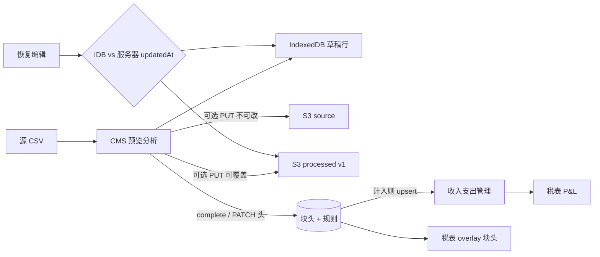
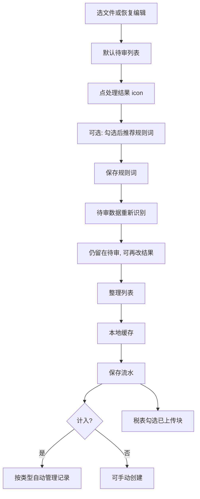

# 流水入账（最终方案）

Last updated: 2026-10-25

Skill checklist：`.cursor/skills/ledger-intake/SKILL.md`。货币 / 汇率 / 计不计入账目见 **[商户记账货币](../merchant-currency/README.md)**（权威，本文不重复公式）。

CMS 财年工具。分析在浏览器完成，再按**数据块**保存。两种用途不要写进同一套入账路径：

- **澳元（块货币 = 商户货币）**：不会录入最终账目；用来发现收入、支出管理漏记，再**手动**补管理记录。
- **外币（块货币 ≠ 商户货币）**：汇总本块各类收支，按**该块**汇率换成商户货币后，每种类型最多自动写入 1 条管理记录。

税表 overlay 只读**已上传块头**汇总，不读行明细。计入块的 P&L 以自动管理记录为准。

行上「蓝计入 / 红排除」是**分类结果**；块上「计入账目汇总」是**相对商户货币**的入账开关。二者不是同一件事。

## 结论

| 项 | 最终约定 |
|----|----------|
| 分析 | 纯客户端（CSV 解析、规则匹配、AI 建议应用都在 CMS） |
| 行数据 | 不进 Postgres。草稿在 IndexedDB；有文件时在 S3 processed CSV |
| 库里 | 分类规则 + 已上传块头（可选 S3 key + 标量汇总 + 源货币 + 块汇率） |
| 草稿 | `persistStatus=draft` 只存在浏览器，CHECK 约束不允许写入 DB |
| 保存 | 按钮「**保存流水**」。须知：取消 / **仅保存统计** / **保存统计与文件** |
| 仅统计 | 只有块头，无云端文件；**不能**恢复编辑，须重新导入 |
| 有文件 | 源文件不可换；之后用「数据块更新」覆盖 processed + PATCH 头 |
| 删除 | 删块头 + S3 对象；计入时自动管理记录 `ON DELETE CASCADE` |
| 默认列表 | 导入或「恢复编辑」打开预览时，筛选停在**待审** |
| 处理结果 | 行上 icon；最新改动为准（人工 / AI 复查比时间） |
| 规则词 | 按行上结果保存；对方 `COUNTERPARTY`，商品名 `PRODUCT_TITLE`，银行摘要 `DESCRIPTION` |
| 保存规则 | 不改行、不整理列表；点亮「待审数据重新识别」；已选词保持绿色 |
| 重新识别 | 只跑仍为待审且非手工锁定的行；结果仍留在待审，等用户点「整理列表」 |
| 整理列表 | 唯一把已定行移出待审筛选的操作（清 pin，切到第一个已定分类）。银行「支出」未选手类型的行忽略，仍留待审 |
| 董事借款 | 成对 **loan from / to director**，不用 repayment 文案 |
| 文件读 | 登录后短时签名 GET；接口不回 S3 key；backend 不中转字节 |
| 货币与入账 | 见 [商户记账货币](../merchant-currency/README.md) |

## 存储分工

| 位置 | 存什么 |
|------|--------|
| `platform.ledger_classify_rules` | 行业/领域电商规则，不分区 |
| `merchant.ledger_classify_rules` | 商户规则，`HASH(merchant_id)` 50 分区 |
| `merchant.ledger_analysis_blocks` | 已上传块头，HASH 50。无行表。`source_key` / `processed_key` 可空 |
| `revenues` / `expenses`.`ledger_block_id` | 计入块自动管理记录（每类型最多 1 条） |
| S3 source | 原始文件 `merchant/{id}/ledger-intake/{fy}/{blockId}/source/...`（仅「保存统计与文件」） |
| S3 processed | 分析后 CSV `.../processed/v1.csv`（`LEDGER_PROCESSED_FORMAT_VERSION = 1`） |
| IndexedDB `xituan_ledger_intake` / `local_blocks` | 本地草稿整块（含 lines、可选 currency / fxToMerchant） |

已废弃且已从库删除：`partner_payment_titles`、`ledger_analysis_block_lines`、块内 `rows jsonb`。合作商打款抬头改为银行规则（`PARTNER_INCOME` + `DESCRIPTION`）。

## 数据块管理

一块 = 一次导入（一个源文件或一次仅统计保存）在某个财年下的银行 **或** 电商分析结果。列表、保存、删除、计入入账都以块为粒度，不以行为粒度写库。

### 生命周期

| 状态 | 识别 | 列表 | 恢复编辑 | 保存后再改 |
|------|------|------|----------|------------|
| 本地草稿 | `persistStatus=draft`，id 前缀 `local:` | 排在已上传块前面 | 本机 IndexedDB | 「保存流水」升级为已上传 |
| 仅统计 | 已上传且 `hasCloudFiles=false` | 状态「仅统计」 | **否**，须重新导入 | 可用同一 `blockId` 再 complete 覆盖头（含计入同步） |
| 已存文件 | 已上传且 `hasCloudFiles=true` | 状态「已存文件」 | 签名 GET processed；本地更新则提示上传才同步 | 「数据块更新」：processed PUT + PATCH，**不能换源文件** |

删除：整块删除。已上传则删 DB 行（CASCADE 自动管理记录）并尽力删 S3；草稿只删 IndexedDB。

### 保存须知（「保存流水」）

未上传或仅统计走确认框，**不是**直接 PUT：

| 按钮 | 行为 |
|------|------|
| 取消 | 不写库、不传文件 |
| 仅保存统计 | `complete` 只写块头（无 source/processed key） |
| 保存统计与文件 | 浏览器直传 source + processed，再 `complete` 带 key |

计入块在确认前必须填块汇率；缺汇率 `LEDGER_BLOCK_FX_REQUIRED`。complete / PATCH 成功后服务端 `syncAccountingBooks`（规则见货币文档）。

已有云文件时主按钮改为「数据块更新」，不再出三选一须知，仍走同一套计入同步。

### 预览工具条（块级，不是行级）

顺序：匹配语种（默认 + 额外均为 badge 按钮）→ **流水货币 / 商户货币** `{A} / {B} / {计不计}` →（仅计入）**汇率**。一个 ⓘ 覆盖整组货币说明。

| 控件 | 规则 |
|------|------|
| 流水货币 `{A}` | CBA / 支付宝只读 badge；标准银行、标准电商下拉，默认 AUD |
| 商户货币 `{B}` | 只读 badge AUD，文案不加「默认」 |
| `{计不计}` | 只读 **badge 状态样式**（不可点）。`块货币 !== 商户货币` 为计入（positive）；相同为不计入（caution） |
| 汇率 | 仅计入时显示；界面 1 商户货币 = 多少源货币，保存时取倒数写入 `fx_to_merchant` |

页头用途说明：`purposeAud`（不进最终账目、手动补管理记录）/ `purposeFx`（换算后按类型自动写入）。

### 行上「创建」

只服务 **不计入** 对账（`countsTowardAccountingSummary === false`），**不按**银行/电商数据源决定列是否出现。银行、电商表都显示该列；链接文案为「创建」。预填收入/支出编辑器，保存为**手工**管理记录。禁止带 `ledger_block_id`，否则删块会误删补记。计入块不显示此列。

### 列表与预览 API 约定

- 列表/详情 **不返回** `sourceKey` / `processedKey`，只给 `hasCloudFiles`。
- `GET /blocks/:id` **不返回 lines**。
- 读文件：`GET .../:id/source|processed` → `{ getUrl }`，短时签名。

## 数据结构

共享类型：`xituan_codebase/typing_entity/ledger-intake.*`、`typing_api/ledger-intake.type.ts`。

### 两种流水

| | 银行 / CBA | 电商 / 支付宝 |
|--|--|--|
| `epLedgerKind` | `bank` | `commerce` |
| 源币种 | CBA 锁 AUD；标准银行默认可选 AUD | 支付宝锁 CNY（界面 RMB）；标准电商默认可选 AUD |
| 匹配文本 | 摘要 `description` | 商品名 / 对方，按 `matchField` 分列 |
| 处理结果 | `epBankClassifyAction` + 支出时 `expenseType` | `epCommerceCategory` |
| 行锁 | `actionLocked`：锁定后分析不再用规则覆盖 | 无字段；CMS 用 `resultClockRef` 记手工/AI 时间 |
| 上传行 | processed CSV **全量**（含忽略/待审） | 同样全量写入 processed；税表 P&L **不加** 排除/待审 |

电商类别：原材料 / 耗材 / 设备 / 海外 / 费用 / 排除 / 待审。设备且金额 `< 300` 匹配成耗材。标题或来源识别「海外税费」等可直接标海外。

银行动作：合作商收入、网银平台提现、订单收入、设备处置、支出、借给董事（loan to director）、向董事借款（loan from director）、忽略、待审。金额符号另分 `epBankRowGroup`（收入/支出/退款）。向董事借款是收入组动作，进税表负债 `loanFromDirector`（与电商垫付并列加总，报表页再与借给董事净额对冲）。

### 规则

`iLedgerClassifyRule`：`ledgerKind`、`matchField`、多语 `pattern`、`action`，电商另有 `category`，银行另有 `bankAction` / `partnerId` / `expenseType`。

范围优先级：商户 > 领域 > 行业。同一范围内：**最长关键词**优先；同长度时已决结果压过纯待审。

匹配字段：

- 电商 `COUNTERPARTY` 只打对方列；其余电商规则只打商品名；`DESCRIPTION` 规则跳过电商匹配。
- 银行只打英文 `DESCRIPTION`。

### 块头

列表/税表用的是标量汇总（电商各类 count/amount，银行收入支出退款忽略/借给董事/向董事借款/工资/合作商匹配数），不是 JSON 行数组。另有 `currency`、可选 `fx_to_merchant`。`GET /blocks/:id` **不返回 lines**。

## 页面结构与能力

入口：`xituan_cms/src/pages/financial/ledger-intake.tsx`。

### 主页面（Drawer 外）

1. 财年、导入按钮（标准收支 / CBA / 标准电商 / 支付宝）。
2. 银行、电商两份数据块列表（桌面表 + 移动卡片）：恢复编辑、整块删除。本地草稿排在已上传块前面。
3. 规则 Tabs：电商规则（多语关键词 + 处理结果）；收支款规则（英文关键词 + 银行动作）。全部分类分组默认显示（含空组）。关键词 badge 可拖到其他分组，松开后更新该规则的处理结果；保存规则只点亮重新识别，不自动跑行。

### 预览 Drawer

- 未上传 / 仅统计：取消、本地缓存、「保存流水」（二次须知，见「数据块管理」）。
- 已存文件：取消、「数据块更新」（不能换文件）。
- 内联「怎么处理」四步，样本 CSV 链在选文件说明里。
- 块级工具条：匹配语种、货币类型、商户货币、计入标签、计入时汇率（见「数据块管理」）。
- 匹配语种：默认语种 + 可勾选额外语种（电商改语种会按原始行重跑规则）。
- 分类筛选在「选择文件」下一行。电商一行；银行三行：收入种类、支出种类、`全部` + 忽略/退款/待审。种类含未匹配到的 0 条。两行 `{名称} {N}` / `{金额}`，圆角 8px。待审琥珀、排除红、**行分类**计入蓝（不是块级「计入账目汇总」）。银行、电商表「处理结果」都在最右列；不计入块可在其左侧「创建」手工补管理记录（不要带 `ledger_block_id`）。本币银行行标成借给/向董事借款时，可「关联」已有对应收入/支出，或「创建」`LOAN_TO_DIRECTOR` 支出 / `LOAN_FROM_DIRECTOR` 收入。计入外币块保存时自动合计并写入一条向董事借款收入（删块 CASCADE）；外币不自动写借给董事。对端日期/合作商/结算单列已去掉。
- 行：处理结果 icon（蓝计入 / 红排除 / 琥珀待审）。电商勾选后对方和商品名分词成可点徽章；银行摘要在推荐完成后分词。本地分词仍用 `Intl.Segmenter`，但会把相邻被拆开的汉字物品名合成 2–3 字词；AI 返回更长整词时继续合成（「剪刀」）。已登记未选中=默认样式；当前选中=绿色（保存后仍绿）。推荐会给每条勾选行一个具体词。AI 词若出现在标题里，按原文位置切开误粘的本地分词再合并（`式洗/鼻器` → `式` + `洗鼻器`）。对不上的行再从该行现有词里补一个物品名。`sales` / `Foods` / 订单号等泛词或编号不自动勾。
- 工具条顺序：已选条数 → AI 复查（不计入时与「日期金额匹配」组合）→ 推荐规则词 → 保存规则词 → 取消推荐 →（待审时）待审数据重新识别 → 整理列表。
- 日期金额匹配（仅不计入）：对勾选行一次请求。服务端用并集日期窗（所选最早日往前 4 周至最晚日）+ 已 round 的金额 `IN`，订单 / 结算入账（revenues 上的 sourceId）/ 支出各查一次，再按行分配。结算单详情由前端用 summaryId 调现有结算单 API。命中后切处理结果，显示「查看详细」，多条时旁挂 Select。

弹窗：规则词冲突（列冲突词 + 同一套结果 icon）；银行绑定打款 title；保存流水须知；不计入块的手工收入/支出编辑器。

### 会话状态（不要和存储混淆）

| 状态 | 作用 |
|------|------|
| `pinnedClientIds` | 已定结果的行仍出现在待审筛选里，**不改变导入顺序、不置顶** |
| `resultClockRef` | `{ at, source: manual \| ai }`。复查返回时：复查开始之后的手工改动保留；否则用 AI 结果 |
| `keywordSelection` | 各列 token 是否绿选 |
| `recommendSuggestions` | AI 荐词；用于把「剪+刀」合成「剪刀」等整词 |
| `rematchReviewReady` | 保存规则后可点重新识别；跑完后关掉 |

## 操作流程

1. **导入 / 恢复**：解析在本地；按财年丢掉范围外日期。预览默认待审。
2. **定结果**：AI 复查是初稿。之后以时间更新的改动为准。复查进行中又改的行，复查返回不覆盖。
3. **规则词**：勾选行随时可推荐，**不依赖复查簇**。模型只从商品名/摘要抽词；对方要用户自己点。保存时若同一关键词已挂在别的处理结果（或本批内部结果不一致），弹冲突列表，选一个最终方案再写入。
4. **重新识别**：用最新规则只打待审未手工锁的行。不自动整理。
5. **整理列表**：清 pin/勾选/推荐高亮，切到第一个非待审分类。银行处理结果为支出但未选具体支出类型的行忽略，仍留在待审。
6. **本地缓存**：IndexedDB。关 Drawer 不自动问（当前未做未缓存询问）。
7. **保存流水**：须知三选一（见「数据块管理」）。计入则同步管理记录。之后有文件的块用「数据块更新」。

AI 复查与推荐：只处理已勾选行；未选为 0，不回落到整批待审。单次上限见 `AI_REVIEW_ITEM_LIMIT`（50）。

## 数据流转与处理逻辑

### 客户端分析

- 银行：`bankLedgerAnalyzeUtil.analyze`。`actionLocked` 为真时不重跑规则。无命中且无动作 → 待审。收入组待审可升成订单收入（金额/日期近邻）。合作商收入对结算候选；支出对已有费用。供应商名/别名派生支出规则。内置 Stripe/Omipay 提现规则。
- 电商：`commerceLedgerAnalyzeUtil.analyze`。只保留成功交易。规则按 `matchField` 打对应列。未命中 → 待审。

### 重新识别

刷新 context 规则后：

- 银行：手工过的行保持锁定；非待审保持锁定；仅未手工的待审解锁给规则。命中后 pin 在待审。
- 电商：`source === manual` 或已非待审的行跳过。命中后改 category 并 pin。

### 保存规则词

按行当前结果 `createRule`；已有同字段同规范化词则跳过创建，冲突词走 `updateRule`。保存后刷新 context，**不**对行 rematch。已选徽章保持绿色。

### 保存与税表

细节见上文「数据块管理」。电商确认里的「计入笔数」指**行分类**可进汇总的类别（原材料/耗材/设备/海外/费用），不是块级「计入账目汇总」。待审/排除仍可写入 processed 和块头 `review_*` / `excluded_*`，但不进自动管理记录、也不进 overlay 费用。

税表 overlay：`getBlocksByIds` 只加总 **块级计入** 的块头。电商旁路用财年 `fxCnyToAud` 展示。P&L 以管理记录为准。`loanFromDirector` = 电商垫付（含设备）+ 银行「向董事借款」。报表页再把 `loanToDirector` 与 `loanFromDirector` 净额对冲。汇率与类型映射：[商户记账货币](../merchant-currency/README.md)。

### HTTP（CMS，merchant + TAX_RETURN）

相对 `/api/admin/financial`：

- `GET ledger-intake/context`
- `GET/POST/PUT/DELETE ledger-intake/rules`
- `GET ledger-intake/blocks`
- `POST ledger-intake/blocks/presign`（`processedOnly` 只签 processed）
- `POST ledger-intake/blocks/complete`
- `GET ledger-intake/blocks/:id`（无行）
- `GET .../:id/source` / `processed`（登录后短时签名 GET；响应只有 `getUrl`，不回 S3 key）
- `PATCH ledger-intake/blocks/:id`
- `DELETE ledger-intake/blocks/:id`

平台电商规则：`/api/admin/platform/ledger-classify-rules`。

AI 信封与 prompt 槽位见 [../ai/ledger-ai-use-cases.md](../ai/ledger-ai-use-cases.md)。复查只看商品名（银行把摘要填进同一字段）；荐词只从标题/摘要抽短词，服务端用 cluster 回填 action/category。

## 关键路径

| 层 | 路径 |
|----|------|
| CMS 页 | `xituan_cms/src/pages/financial/ledger-intake.tsx` |
| 本地缓存 | `ledger-intake-local-cache.util.ts` |
| S3 PUT | `ledger-intake-s3.util.ts` |
| 匹配 | `xituan_codebase/utils/ledger-classify-rule.util.ts` |
| 分析 | `bank-ledger-analyze.util.ts` / `commerce-ledger-analyze.util.ts` |
| processed CSV | `bank-ledger-processed-csv.util.ts` / `commerce-ledger-processed-csv.util.ts` |
| 源货币 / 计入判定 | `ledger-source-currency.util.ts` |
| 自动入账映射 | `xituan_backend/src/domains/financial/utils/ledger-intake-books.util.ts` |
| Backend | `xituan_backend/src/domains/financial/{routes,controllers,services,infrastructure}/ledger-intake.*` |
| 迁移 | `1710000000376` 起：0380 无行表；0381 向董事借款；0382 文件可选；**0383** `ledger_block_id` + `fx_to_merchant` |

## S3 读权限

源文件与 processed CSV 的 key 为 `merchant/{id}/ledger-intake/...`。四环境桶对 CloudFront **Deny** 该前缀的 `s3:GetObject`（content/media 匿名 GET 为 403）。读文件只走本页 HTTP 的签名 GET。登记与改策略流程：[../s3/README.md](../s3/README.md)。

## 相关文档

- [../../.cursor/skills/ledger-intake/SKILL.md](../../.cursor/skills/ledger-intake/SKILL.md) — agent checklist
- [../merchant-currency/README.md](../merchant-currency/README.md) — 商户货币 / 计入规则 / 入账汇率（权威）
- [../s3/README.md](../s3/README.md) — 私有前缀 CDN Deny / 桶策略
- [../ai/ledger-ai-use-cases.md](../ai/ledger-ai-use-cases.md) — AI HTTP / prompt / 输出信封
- [../tax-return-report-design.md](../tax-return-report-design.md) — 税表快照与锁定
- [../cross-client-business-error-handling.md](../cross-client-business-error-handling.md) — AI 错误码 Shape A
