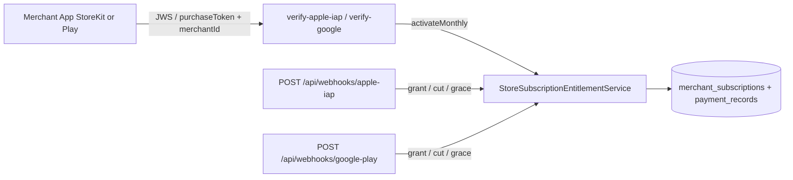

# 平台订阅 · 商店渠道（Apple IAP / Google Play）最终方案

Last updated: 2026-11-20

本文为 **store 渠道月订**（App Store / Google Play）与后端统一权益、Webhook 标准流程的权威说明。Agent 工作清单见 skill **`platform-store-iap-subscription`**。

与 `platform-subscription-billing-devplan.md` 的关系：该文偏 Stripe/Airwallex 等 **钱包周期扣款** 方向；**商店内购自动续订** 走本文，二者解耦，但共用 `merchant_subscriptions` 状态机与功能权限。

---

## 1. 结论摘要

| 主题 | 定稿 |
|------|------|
| 权益写入 | 唯一入口：`StoreSubscriptionEntitlementService`（`activateMonthly` / `cutAccessNow` / grace / auto-renew） |
| 客户端 | 验票 API 激活；**不**信任本地「已购买」而不校验 |
| Apple 绑定 | 同一 `originalTransactionId` 同时仅一个商户 **占有**；结束后可接手 |
| 占有定义 | `APPLE` + `RECURRING` + `current_period_end >= today`；prepaid/bulk **不算**占有 |
| Webhook | ASN /（未来）Play RTDN 只做验签与事件映射 → 同一 entitlement 操作 |
| iOS 预付 SKU | verify **拒绝**；月订走自动续订组 |
| 价格 | 实付价只在商店后台；平台 ×1.15 仅为抄档建议，不入库 |

---

## 2. 端到端架构

| 层 | 职责 |
|----|------|
| App | 拉价、发起购买、`appAccountToken=merchantId`、仅把**本次**新交易送验票、成功后再 `finishTransaction` |
| Verify | 验签、过期/撤销/商店状态、占有断言、调用 core |
| ASN / RTDN | 验签、解析商户、映射通知类型 → core |
| Core | 账期、status、`external_subscription_id`、payment 幂等、清其他商户 OTID、feature cache |

禁止：Webhook 或 verify 旁路直接 `UPDATE` 账期；为 Google 再抄一套 activate SQL。

---

## 3. 数据与占用

### 3.1 关键字段

- `merchant_subscriptions.external_subscription_id`：Apple = `originalTransactionId`；Google = 稳定订阅标识（purchase token / order id 策略实现时与 core 对齐）
- `subscription_payment_records.external_payment_id`：单次 `transactionId`（幂等）
- `provider`：`apple` / `google` / `stripe` / …
- `billing_mode`：store 月订固定 `recurring`

### 3.2 占有与接手（Apple）

1. **占用中**：存在满足占有定义的行且 OTID 匹配 → 仅该商户可 verify / 续费发权。
2. **可接手**：无占有者（已过期、`cutAccessNow`、或商户已改 prepaid/bulk）→ 商户 B verify 可激活。
3. **激活时**：`nullifyExternalSubscriptionIdByValueExceptMerchant(OTID, B)`，再写入 B。
4. **历史 payment 不永久绑死**；ASN 发权优先占有者，避免 JWT 里残留的 `appAccountToken=A` 误发到 A。
5. 接手后 best-effort：`Set App Account Token` → B 的 UUID（与 Apple 账户映射推荐一致）。

业务错误：`SUBSCRIPTION_APPLE_IAP_BOUND_TO_OTHER_MERCHANT`（商户 App i18n 已配）。

---

## 4. Verify 标准闸门（Apple）

顺序固定：

1. `merchantIapProductMapUtil` → 仅 `monthly`
2. JWS / Server API 验交易
3. 拒绝 `revocationDate`
4. 拒绝 `expiresDate <= Date.now()`
5. `getAllSubscriptionStatuses` ∈ Active / BillingRetry / Grace
6. `findAppleChainHolder` 冲突则 BOUND
7. `activateMonthly` + `setAppAccountToken`

防止「设备残留 cancelled 交易 + 有效至今天」误开通（曾导致无 ASN、管理订阅仍 cancelled）。

---

## 5. 商户 App 购买约定（iOS）

路径：`xituan_app_merchant/src/utils/iap/merchant-iap-storekit.util.ts`

| 规则 | 原因 |
|------|------|
| 购买前/遇 stale 时 finish + `clearTransactionIOS` 再 request | StoreKit 会重放旧 tx，不弹订阅页 |
| 只接受本轮 `transactionDate` 新鲜且未过期 | 避免假成功 |
| reconcile 仅 `onlyIncludeActiveItemsIOS: true` | cancelled 不得冒充新购 |
| Modal 失败用 Alert | toast 被遮挡 |
| 成功验票后再 finish | 与后端激活一致 |

Google：应对齐同一「新鲜交易 + 验票后再 acknowledge」模式（实现时挂同一 skill）。

---

## 6. Webhook 标准订阅处理流程

适用于 Apple ASN V2；Google Play RTDN / PubSub 接入时 **复用同一映射表精神**。

| 商店事件（概念） | Core 操作 |
|------------------|-----------|
| 购买付款成功（状态 `ACTIVE` 且交易号、商品对上） | `activateMonthly` |
| 新订 / 续费扣款成功（`DID_RENEW`，含 `BILLING_RECOVERY`）/ 重新订阅 | `activateMonthly`（`changeKind` renew/initial/upgrade…） |
| 降级偏好 | 挂起 pending downgrade；到期再 `applyPendingDowngradeIfDue` |
| 关闭/打开自动续订 | `setAutoRenewDisabled` / `Enabled` |
| 续费没扣到（`DID_FAIL_TO_RENEW`） | 只记录。不改 `current_period_end`，不改系统 7 天 `grace_period_end`，不停功能 |
| 续费链结束（`EXPIRED` / `GRACE_PERIOD_EXPIRED`）且系统 7 天已过 | `cutAccessNow`。7 天未过则不停，交给到期任务进只读 |
| 退款 / 撤销 | 立刻 `cutAccessNow` |
| TEST | 记日志，不改权益 |

入口：

- Apple：`POST /api/webhooks/apple-iap`（`AppleIapWebhookController`）
- Google：预留 `POST /api/webhooks/google-play`（验签后调用同一 core）

应答：验签成功并处理后 **200**；验签硬失败可 400（避免 ASN 无限脏重试时按 Apple 文档权衡）。

### 6.1 本地沙盒 ASN

1. Backend `:3050` + `cloudflared tunnel --url http://127.0.0.1:3050`
2. Connect → App Information → Sandbox Server URL =  
   `https://<trycloudflare-host>/api/webhooks/apple-iap`
3. Quick Tunnel **每次重启换 host**，必须改 Connect；可用 Server API `requestTestNotification` 探测（quick tunnel 偶发 `UNSUCCESSFUL_HTTP`，可用同 payload 经隧道重放确认 200）

详见 `cloudflared-tunnel-setup.md`。

---

## 7. 与钱包订阅共存

| | Store (Apple/Google) | Stripe / Omipay |
|--|----------------------|-----------------|
| 续费权威 | 商店 + ASN/RTDN | PSP Billing + webhook |
| Core | `StoreSubscriptionEntitlementService` | `StripeRecurringAdapter` 等 |
| 互斥 | `assertStoreMonthlyAllowed`：有效 prepaid（非同店误标）或他渠 recurring 未结束时拦截 | 既有 cancel / pending 逻辑 |

切店月订前若仍挂 Stripe 订阅 id，core 内会尝试取消钱包侧再写入 store recurring。

---

## 8. 关键源码索引

| 模块 | 路径 |
|------|------|
| 权益核心 | `xituan_backend/src/domains/subscription/services/store-subscription-entitlement.service.ts` |
| Apple 验票 | `.../apple-iap-verify.service.ts` |
| Apple ASN | `.../apple-iap-asn.service.ts` |
| 占用 | `.../utils/apple-iap-merchant-bind.util.ts` |
| Token | `.../utils/apple-iap-set-app-account-token.util.ts` |
| SKU 映射 | `submodules/xituan_codebase/utils/merchant-iap-product-map.util.ts` |
| 商户购买 UI | `xituan_app_merchant/src/components/subscription/iap/MerchantIosIapCheckoutModal.tsx` |

---

## 9. 相关文档

- Skill：`.cursor/skills/platform-store-iap-subscription/SKILL.md`
- 钱包/PSP 订阅方向：`platform-subscription-billing-devplan.md`
- Tunnel：`cloudflared-tunnel-setup.md`
- 业务错误形态：skill `business-error-line-errors`
