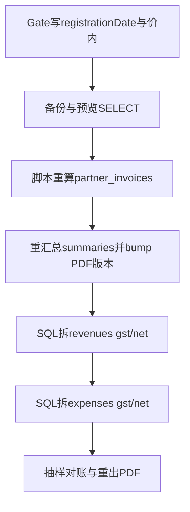

# GST 生效日切齐 — 技术细节（SQL / 字段）

> **大任务说明书：** [`TASK-2-gst-effective-date-cutover.md`](./TASK-2-gst-effective-date-cutover.md)  
> 状态：**未定稿**；纠错可先做，D 切齐等生效日。  
> **手续费 / OmiPay 已收款：** 仅见 Cursor plan `stripe_fee_auto_expense`，**不在本文**。  

---

## B. GST 切齐 — Gate（先于任何批量更新）

1. 写入 `finance.gst.isRegistered = true`
2. 写入准确 `finance.gst.registrationDate = 'YYYY-MM-DD'`（下称 **D**）
3. 确认 `isPriceInclusiveGst`（默认按现网 PDF：**价内 `true`** — 目录价含税观感；未注册时 PDF 不拆 GST）
4. 备份：相关表 dump / 事务外先 `SELECT` 计数与金额抽样

判定函数：`gstRegistrationUtil.isRegisteredOnDate` — `eventDate >= D` 才计 GST。

**产品默认（已选定）：价内。**  
- 消费者订单 **实付金额不改**（钱已收）；生效后主要是 **拆 gst/net 展示与账本**。  
- 价外若日后改价，属定价变更，不在本批「补历史 GST 列」范围。

---

## C. 按对象：要不要 SQL、怎么算

### C1. 订单 `merchant.orders` / `order_items`

| 点 | 说明 |
|----|------|
| 库表 | **无** `gst_amount` 列；行价/合计已是实收口径 |
| PDF/单据 | [`order-document-pdf-gst.util.ts`](../../xituan_backend/src/domains/order/utils/order-document-pdf-gst.util.ts) **渲染时**按 `isRegisteredOnDate(eventDate)` 拆税 |
| 批量 SQL | **不改** `total_amount` / `final_amount` / `charged_amount`（价内默认） |
| 生效后 | 设好 D 后，对 `eventDate >= D` 重出 PDF 即显示 GST；`< D` 仍无 GST |

（订单金额列不因 GST 纠错而改；OmiPay 已收款订正见手续费 plan。）

### C2. 送货单 `merchant.partner_invoices`（发货/合作发票）

| 点 | 说明 |
|----|------|
| 存库 | `gst_amount` + `detail` JSONB（行上 `unitPrice`/`gst`/`amount`/`gstAmount`…） |
| 创建时 | 按当时 `isRegisteredOnDate(issue_date)` 算死 |
| 风险 | D 写入前已开、且 `issue_date::date >= D` 的票可能 **gst=0 未拆** |

**不要手写复杂 JSONB SQL 改行。** 用后台脚本：对候选发票调现有 `calculateInvoiceDetailItem` / `calculateInvoiceSummary` 重算后 `UPDATE` 头字段 + `detail`，并 bump 关联 summary 的 `doc_content_version`。

候选条件：

```sql
SELECT id, pack_code, issue_date, total_amount, gst_amount
FROM merchant.partner_invoices
WHERE merchant_id = :mid
  AND (issue_date AT TIME ZONE 'UTC')::date >= :D::date
  AND gst_amount = 0
  AND total_amount > 0;
-- 另：gst>0 但注册前误算的需人工抽样，不默认全翻
```

### C3. 结算单 `merchant.partner_invoice_summaries`

| 点 | 说明 |
|----|------|
| 存库 | `total_amount` / `total_loss` / `total_paid` 等汇总；**无单独 gst 列** |
| 动作 | 所含发票重算后 **重汇总**；`doc_content_version = doc_content_version + 1` 触发生成新 PDF |

```sql
-- 找出含「需重算发票」的 summary（示意）
SELECT DISTINCT s.id, s.summary_code
FROM merchant.partner_invoice_summaries s
JOIN merchant.partner_invoices i ON i.summary_id = s.id AND i.merchant_id = s.merchant_id
WHERE s.merchant_id = :mid
  AND (i.issue_date AT TIME ZONE 'UTC')::date >= :D::date;
```

### C4. 收入 `merchant.revenues`（尊重出单时商户 GST 状态）

- 账务 / 单据：按 **收入业务日 / 合作票 `issue_date`** 对应的商户注册状态拆销项税（`isRegisteredOnDate`），**不是**「今天才注册就回刷所有历史收入」。
- 创建时若未传 gst：按 `revenue_date` 是否注册做价内拆分。
- **D 写入前**已落库、且 `revenue_date >= D` 的行常为 `gst_amount=0` → 生效窗口只补这类。
- `revenue_date < D`：**保持 gst=0**（出单时未注册，不补销项）。

```sql
-- 预览
SELECT id, revenue_type, revenue_date, total_amount, gst_amount, net_amount
FROM merchant.revenues
WHERE merchant_id = :mid
  AND revenue_date >= :D::date
  AND revenue_type <> 'loan_from_director'
  AND ABS(gst_amount) < 0.005
  AND ABS(total_amount) >= 0.01;

-- 价内拆分（与 gstRegistrationUtil.splitInclusiveTotal 一致：gst = round(|total|/11,2)）
UPDATE merchant.revenues
SET gst_amount = ROUND(ABS(total_amount) / 11, 2) * SIGN(total_amount),
    net_amount = total_amount - (ROUND(ABS(total_amount) / 11, 2) * SIGN(total_amount)),
    updated_at = NOW()
WHERE merchant_id = :mid
  AND revenue_date >= :D::date
  AND revenue_type <> 'loan_from_director'
  AND ABS(gst_amount) < 0.005
  AND ABS(total_amount) >= 0.01;
```

`SIGN`：Postgres 用 `CASE WHEN total_amount < 0 THEN -1 ELSE 1 END`。退款负金额保持符号。

### C5. 支出 `merchant.expenses`（与「自己是否注册 GST」的关系）

**口径（与现网 `ExpenseService.calculateGstAndNet` / 报税一致）：**

| 概念 | 说明 |
|------|------|
| 供应商收据上的税 | 对方开票事实；**能否记成你的可抵扣进项**取决于 **你在 `expense_date` 是否已注册** |
| 库里的 `gst_amount` | = **你可主张的 input GST**，不是「收据上印了多少就无条件写入」 |
| 未注册（`expense_date < D` 或未开通） | `gst_amount = 0`，`net_amount = total_amount` → **成本 = 收据总额**（含对方 GST，你拿不回） |
| 已注册且 `expense_date >= D` | 按供应商价内/价外从 `total_amount` **拆** `gst` / `net` → **报税成本用 `net_amount`**；`gst_amount` 进进项税汇总 |

报税统计（`tax-return-report.service`）：成本侧 **一律用 `netAmount`**；GST 表另计 `inputGst = Σ gstAmount`。  
因此：未注册时 net=total → 成本即总额；已注册时成本是去掉可抵扣 GST 后的净额。

**批量 SQL：** 仅对 `expense_date >= D` 且当前 gst≈0 的行，按供应商价内规则补拆（价外/OCR 明细行人工）；**不要**给 `expense_date < D` 的历史支出强行拆 gst（那些日你还不能抵扣，成本应保持总额）。

```sql
-- 仅生效日及之后、且尚未拆税的支出（价内供应商示意）
UPDATE merchant.expenses
SET gst_amount = ROUND(ABS(total_amount) / 11, 2) * CASE WHEN total_amount < 0 THEN -1 ELSE 1 END,
    net_amount = total_amount - (ROUND(ABS(total_amount) / 11, 2) * CASE WHEN total_amount < 0 THEN -1 ELSE 1 END),
    updated_at = NOW()
WHERE merchant_id = :mid
  AND expense_date >= :D::date
  AND expense_type NOT IN ('loan_to_director', 'fine')
  AND ABS(gst_amount) < 0.005
  AND ABS(total_amount) >= 0.01;
-- 价外供应商、带 items 的 OCR 单：排除本批，走脚本/人工
```

Stripe 自动手续费支出：上线后按 **你的** 注册日决定是否拆 gst；历史回填同规则。
### C6. 订单支付记录

GST 本文不订正支付 `amount`。Stripe/OmiPay 已收款与手续费支出 → 手续费 plan。

---

## D. 推荐执行顺序（仅 GST）



1. Gate + 备份 + 预览  
2. 合作送货单脚本重算 → 结算单汇总 + PDF  
3. revenues / expenses GST 列  
4. 抽样 PDF / 报表  

**权限：** 所有破坏性 SQL 须开发者明确批准后再跑（migration-sql 规则）。

---

## E. 用 GST / 不用 GST（判定一览）

| 记录日期（业务日） | `isRegistered` | 结果 |
|--------------------|----------------|------|
| `< D` | true（已开通） | **不计** GST（拆分为 0） |
| `>= D` | true | **计** GST（价内：total 不变，gst=total/11） |
| 任意 | false | **不计** GST |

订单 PDF / 新开票：只读设置，**不必**为「用不用 GST」改订单金额列。

---

## F. 相关索引

- Stripe 手续费 auto-expense plan（Cursor）：收款 fee 绑订单、退款保留支出  
- `gst-registration.util.ts`、`order-document-pdf-gst.util.ts`  
- `invoiceCalculation.util` / partner invoice 创建路径  
- 手续费 / OmiPay 已收款：Cursor plan `stripe_fee_auto_expense`（勿与本文混跑）
